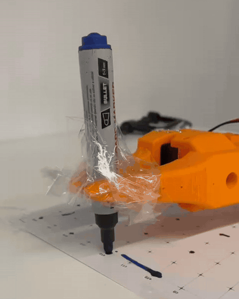
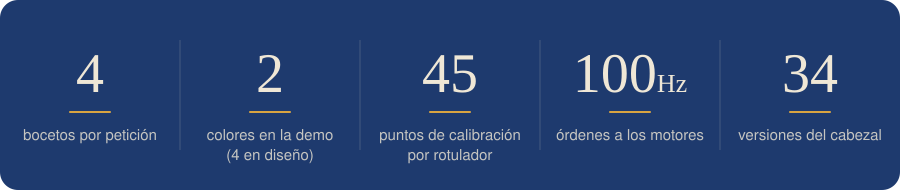
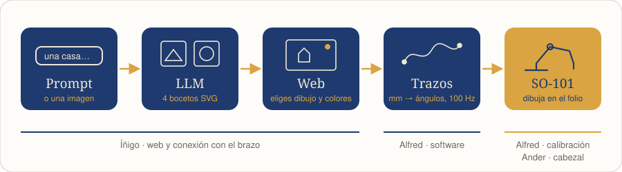
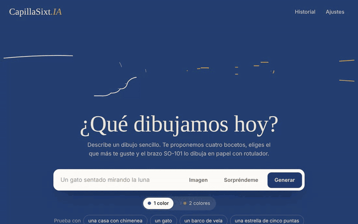
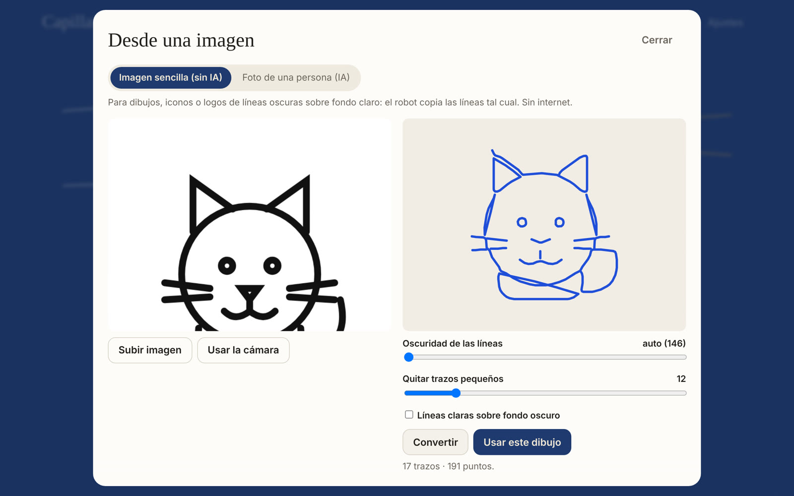
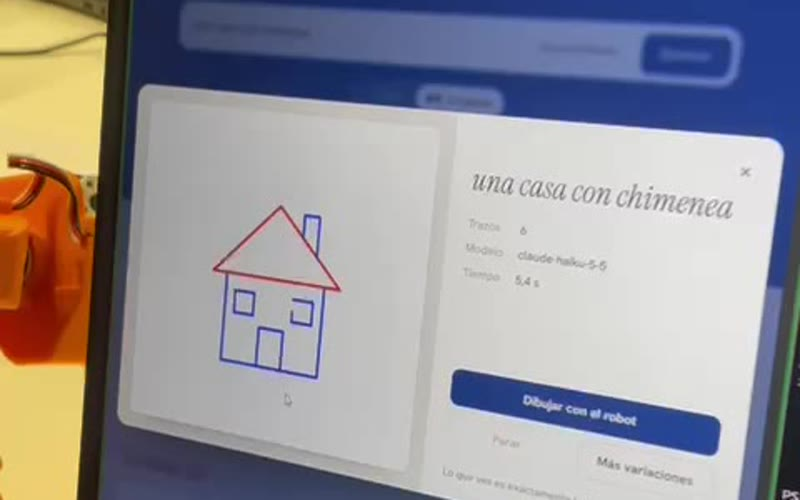
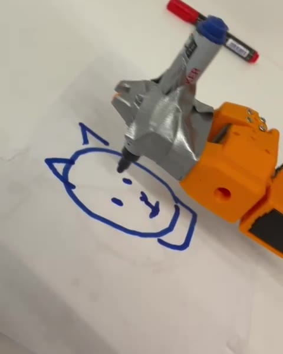
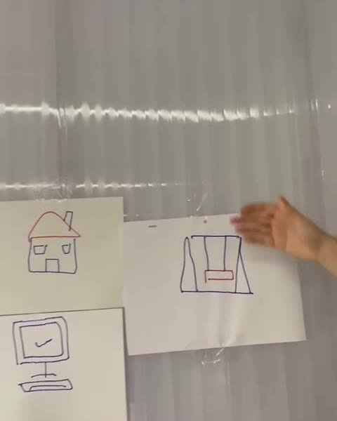
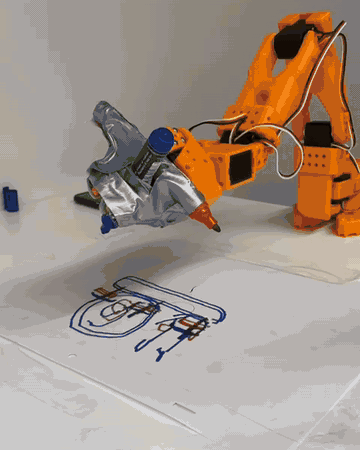

<h1 align="center">Robot pintor SO-101</h1>
<p align="center"><b>Del prompt al papel:</b> escribes lo que quieres, la IA lo boceta y un brazo robótico lo dibuja con rotulador.</p>

<p align="center">
  <a href="https://hackathon.manyagents.es/equipos/capillasixt-ia"></a>
</p>
<p align="center">
  
  
  
  
  
</p>

<p align="center"></p>

<p align="center"></p>

## Cómo funciona

<p align="center"></p>

La idea salió entre todo el equipo en el **Hackathon LeRobot Bilbao II** (La Perrera, Bilbao, 20-22 nov 2026).

| | Quién | Qué hizo |
|---|---|---|
| 🖥️ | **Íñigo Guzmán** (autor) | Web, conexión web → brazo y vídeo |
| ⚙️ | **Alfred Gabriel** | Calibración del brazo y software del robot |
| 🖊️ | **Ander Mont** | Cabezal multicolor en Blender · [su repo](https://github.com/andermont/so101-four-color-pen-holder) |

## La web

<p align="center"></p>

<table>
  <tr>
    <td width="33%"></td>
    <td width="33%"></td>
    <td width="33%"></td>
  </tr>
  <tr>
    <td align="center"><sub><b>Prompt</b> y selector de 1 o 2 colores</sub></td>
    <td align="center"><sub><b>Desde una imagen</b>: líneas sin IA o retrato con IA</sub></td>
    <td align="center"><sub>Boceto <b>a dos colores</b> en la demo real</sub></td>
  </tr>
</table>

- **4 bocetos en paralelo** con el LLM que elijas (Groq, Gemini, OpenRouter o Claude) y vista previa animada trazo a trazo.
- **Lo que ves es lo que dibuja:** el SVG se limpia y se valida antes de mandarlo al brazo (`POST /draw`). Muestra el progreso en vivo y tiene botón **Parar**.
- **Estética Capilla Sixtina:** *La creación de Adán* con una pinza con rotulador en lugar del dedo de Dios.

## Resultados

<table>
  <tr>
    <td width="33%"></td>
    <td width="33%"></td>
    <td width="33%"></td>
  </tr>
  <tr>
    <td align="center"><sub>El brazo dibujando un <b>gato</b></sub></td>
    <td align="center"><sub>Dibujos de la demo</sub></td>
    <td align="center"><sub>De la web al papel, en directo</sub></td>
  </tr>
</table>

## Hardware: cabezal de cuatro colores


Ander diseñó un cabezal para llevar **cuatro rotuladores** y cambiar de color girando la muñeca del brazo.

- **Demo:** montaje de cinta con 2 colores.
- **V23:** primera versión impresa probada.
- **V34:** diseño actual, con 46° entre colores. Pendiente de imprimir.

Todo el proceso está en **[andermont/so101-four-color-pen-holder](https://github.com/andermont/so101-four-color-pen-holder)**.

<br clear="right">

## Software del robot

El código está en [`robot/`](robot/). Sobre el papel no manda la cinemática inversa, sino una **calibración de 45 puntos por rotulador**, colocando la punta a mano sobre una plantilla de cruces e interpolando entre ellos.

<details>
<summary><b>Ver el pipeline completo</b></summary>

- **Calibración** (`calibrar_a_mano.py`): rejilla de 9×5 puntos cada 34 mm por color, con interpolación Catmull-Rom.
- **Nivelación** (`nivelar.py`): mide la altura real de contacto en 5 puntos para que no apriete de más.
- **SVG → trazos** (`svg_a_trazos.py`): pasa a mm, centra en la hoja, agranda los detalles diminutos, simplifica, ordena para viajar lo mínimo y agrupa por color.
- **Movimiento** (`dibujar_ik.py`): baja despacio, pinta, sube y viaja, frenando en curvas, a 100 Hz. Si algo no se alcanza, no se mueve.
- **Cambio de color:** cada rotulador con su calibración; la muñeca gira entre uno y otro.
- **Servidor** (`servidor_robot.py`): `/draw`, `/status`, `/stop` y `/preview`, con parada de emergencia.
- **Dataset:** cada dibujo se guarda como SVG + JSON.

Explicación técnica completa: [`docs/CONTEXTO_PROYECTO.md`](docs/CONTEXTO_PROYECTO.md).
</details>

<details>
<summary><b>Lo que aprendimos</b></summary>

- Calibrar con los motores sin fuerza no sirve: el brazo cede por su peso.
- El modelo cinemático tenía 4–6 mm de error, así que sobre el papel manda la calibración.
- La holgura de los engranajes (~1°, 3–4 mm en la punta) se nota en los detalles pequeños: por eso se agrandan y se frena en las curvas.
- Pocas compensaciones bien entendidas funcionaron mejor que muchas capas de correcciones.
</details>

## Pruébalo

```bat
:: Solo la web: abre web/robot-dibujante.html, pon tu API key en Ajustes y pulsa Generar.

:: Con el servidor en simulación (sin brazo):
cd robot
pip install -r requirements.txt
python servidor_robot.py --simular
```

Con el brazo real, sigue [`robot/README.md`](robot/README.md). Hay que calibrar cada rotulador en tu propio SO-101.

<details>
<summary><b>Estructura del repo</b></summary>

```
web/robot-dibujante.html     la web (un archivo, doble clic)
robot/                       software del brazo (Python + LeRobot)
  servidor_robot.py          servidor HTTP
  svg_a_trazos.py            SVG → trazos en mm
  dibujar_ik.py              calibración → motores y planificación
  calibrar_a_mano.py, nivelar.py, ...  calibración y diagnóstico
  pruebas/                   peticiones de ejemplo
  calibracion_sin_nivelar/   ejemplo de calibración (de nuestro brazo)
  antiguos/                  versiones descartadas
docs/CONTEXTO_PROYECTO.md    explicación técnica completa
media/                       GIF, capturas y gráficos
```
</details>

## Próximos pasos

- 🎨 **Cuatro colores** con el cabezal V34.
- 🔥 **Grabado láser:** el mismo pipeline con un módulo láser sobre madera o aluminio. Las primeras pruebas se hicieron en el hackathon.
- 🎯 **Más precisión** compensando la holgura de los engranajes.

---

<sub>Equipo <b>CapillaSixt.IA</b>: Íñigo Guzmán López, Alfred Gabriel, Nicolás Pascual, Ander Mont y Jon García · Hecho con <a href="https://github.com/TheRobotStudio/SO-ARM100">SO-101</a> y <a href="https://github.com/huggingface/lerobot">LeRobot</a> · Código bajo <a href="LICENSE">MIT</a>; el diseño del cabezal tiene la licencia de su repo.</sub>
