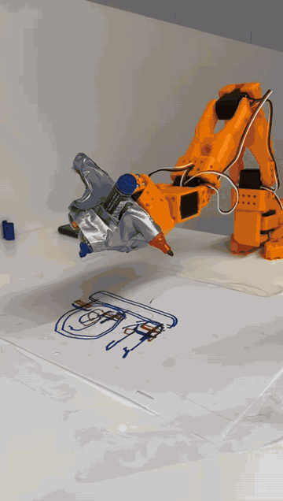
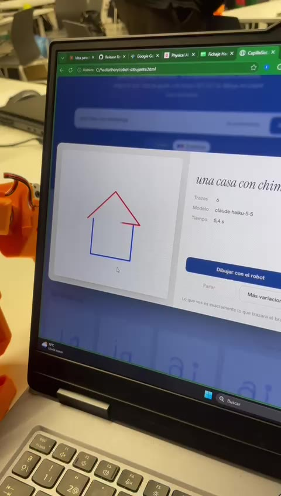
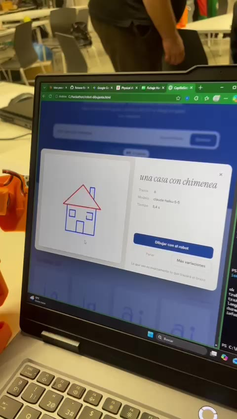

# Robot pintor SO-101: del prompt al papel

Escribes en una web lo que quieres ("quiero una casa") o subes una imagen. La IA te propone **4 bocetos**, eliges uno y el brazo robótico **SO-101** (LeRobot) lo dibuja en un folio con rotulador, a **uno o dos colores**.

Proyecto del equipo **CapillaSixt.IA** en el **Hackathon LeRobot Bilbao II, Physical AI Hackathon** (La Perrera, Bilbao, 20-22 nov 2026).



## Equipo

| Quién | Qué hizo |
|---|---|
| **Íñigo Guzmán** (autor de este repo) | Desarrollo de la web, conexión web → brazo y montaje del vídeo |
| **Ander Mont** | Diseño mecánico y prototipado del cabezal de cuatro colores en Blender (más de 30 versiones) y montaje en el brazo. Repo propio: [so101-four-color-pen-holder](https://github.com/andermont/so101-four-color-pen-holder) |
| **Alfred** | Calibración del brazo y pruebas punto a punto sobre la hoja, y el software del robot: servidor, paso de SVG a trazos, planificación del movimiento y cambio de color |

La idea (un robot que dibuja lo que le pides con lenguaje natural, con una persona participando en la demo) salió entre todo el equipo.

El proyecto se divide en tres piezas que tienen que encajar: **la web** decide *qué* se dibuja, **el cabezal** sujeta los rotuladores y **la calibración y el software del robot** consiguen que el brazo dibuje *donde* debe.

## Estructura del repo

```
robot-pintor-so101/
├── web/
│   └── robot-dibujante.html     la web (un solo archivo, se abre con doble clic)
├── robot/                       software del brazo (Python + LeRobot)
│   ├── README.md                instalar y arrancar
│   ├── requirements.txt
│   ├── servidor_robot.py        servidor HTTP que recibe el SVG y dibuja
│   ├── svg_a_trazos.py          SVG → trazos en mm de la hoja
│   ├── dibujar_ik.py            mapa calibración → motores y planificación
│   ├── dibujar.py, geometria.py, robot_utils.py
│   ├── calibrar_a_mano.py, nivelar.py, ...   calibración y diagnóstico
│   ├── pruebas/                 peticiones de ejemplo para /draw
│   ├── calibracion_sin_nivelar/ calibraciones de los dos rotuladores (antes de nivelar)
│   └── antiguos/                versiones descartadas, solo de consulta
├── docs/
│   └── CONTEXTO_PROYECTO.md     explicación técnica completa
└── media/                       GIF y capturas
```

## Mi parte: la web y la conexión con el brazo
- **Web** ([`web/robot-dibujante.html`](web/robot-dibujante.html)): a partir de un prompt genera 4 bocetos SVG con un LLM y enseña una vista previa animada trazo a trazo. Permite elegir el dibujo y si se hace con uno o dos colores.
- **Desde una imagen:** subes una imagen o haces una foto con la cámara. Hay dos modos:
  - *Imagen sencilla (sin IA):* para dibujos o logos de líneas. Extrae las líneas en el navegador, sin internet.
  - *Foto de una persona (IA):* el LLM hace un retrato sencillo en líneas.
- **Conexión web → brazo:** la web manda el SVG elegido al servidor del robot (`POST /draw`). Va mostrando el progreso ("Trazo X de N") y tiene un botón **Parar** (`POST /stop`).
- **Vídeo:** montaje del vídeo de la demo.

## La web

| Inicio, con selector de 1 o 2 colores | Boceto elegido, listo para dibujar |
|---|---|
|  |  |

**Desde una imagen:** de un dibujo a trazos que el brazo puede seguir, sin IA.

<p align="center"></p>

**Cuatro propuestas para "una casa con chimenea" durante la demo:**

<p align="center"></p>

### Cómo funciona

```
Prompt ("quiero una casa") o imagen
   │
   ▼
Web (HTML + JS, sin backend)
   │  4 peticiones en paralelo al LLM → 4 SVG de líneas (viewBox 0-100)
   │  limpieza y validación del SVG (solo formas básicas, sin scripts)
   │  la persona elige un boceto y si se dibuja con 1 o 2 colores
   ▼
POST http://localhost:8000/draw  {svg}          GET /status · POST /stop
   │
   ▼
robot/servidor_robot.py (Python + LeRobot)
   │  svg_a_trazos → trazos en mm → recorrido 3D → ángulos de motor (100 Hz)
   ▼
Brazo SO-101 dibujando en el folio
```

- **Proveedores de LLM:** Groq, Google Gemini, OpenRouter o Claude. Se eligen en *Ajustes*.
- **System prompt** pensado para que salgan dibujos que un brazo pueda trazar: pocas formas, coordenadas enteras, sin rellenos ni texto.
- **Seguridad:** la API key se guarda solo en el `localStorage` del navegador y el SVG se sanea antes de mostrarlo.
- **Diseño:** inspirado en la Capilla Sixtina, con una versión de *La creación de Adán* en la que una pinza con rotulador sustituye al dedo de Dios.

## Cómo ejecutarlo

**Solo la web, sin robot:**
1. Abre `web/robot-dibujante.html` en el navegador.
2. En **Ajustes**, elige proveedor y pega tu API key.
3. Escribe algo ("un gato") y pulsa **Generar**.

**Con el servidor en simulación** (no hace falta brazo):
```bat
cd robot
pip install -r requirements.txt
python servidor_robot.py --simular
```

**Con el brazo SO-101:** mira [`robot/README.md`](robot/README.md). Hay que calibrar cada rotulador con `calibrar_a_mano.py` y `nivelar.py` sobre la plantilla de cruces. Las calibraciones de `robot/calibracion_sin_nivelar/` son de nuestro brazo y de antes de nivelar, así que sirven de ejemplo del formato, no para otro robot.

## Resultados

| Dibujo a dos colores | Dibujos finales |
|---|---|
|  |  |

## El hardware: cabezal de cuatro colores (Ander Mont)
Ander diseñó un cabezal para llevar **cuatro rotuladores** en la pinza del SO-101 y elegir el color girando la muñeca (`wrist_roll`), que tiene unos 250° útiles.

- **En la demo** usamos un montaje de cinta con **dos colores** (azul y rojo), cada uno con su calibración.
- **La V23** fue la versión impresa que se probó con cuatro rotuladores. Con la holgura del montaje solo se lograron aislar dos colores.
- **La V34** es el diseño actual en CAD: 3 piezas, 46° entre colores y 138° de giro para los cuatro. Falta imprimirla y probarla en el robot.

<p align="center"><br><sub>Cabezal V34, de Ander Mont</sub></p>

Todo el proceso, versión a versión, con los modelos de Blender, los archivos de impresión y el manual de montaje, está en su repo: **[andermont/so101-four-color-pen-holder](https://github.com/andermont/so101-four-color-pen-holder)**.

## La calibración y el software del robot (Alfred)
El código está en [`robot/`](robot/) y la explicación técnica completa, en [`docs/CONTEXTO_PROYECTO.md`](docs/CONTEXTO_PROYECTO.md).

- **Plantilla de calibración:** un A4 impreso con cruces cada 17 mm. Es la referencia física para calibrar y para colocar la hoja siempre igual.
- **Calibración por rotulador:** 45 puntos (rejilla de 9×5, uno cada 34 mm) para cada color, colocando la punta a mano en cada cruz (`calibrar_a_mano.py`). Entre puntos se interpola con Catmull-Rom; con puntos más separados las curvas se deformaban.
- **Nivelación:** se mide la altura real de contacto con el papel en 5 puntos (`nivelar.py`), para que el rotulador no apriete de más ni se quede en el aire.
- **De SVG a trazos** (`svg_a_trazos.py`): el SVG se convierte en polilíneas en milímetros. Se encaja y centra en la hoja, los detalles diminutos se agrandan o se convierten en puntos, se simplifica, se ordenan los trazos para viajar lo mínimo y se agrupan por color.
- **Planificación del movimiento** (`dibujar_ik.py`): bajar despacio los últimos milímetros, pintar, subir y viajar, frenando en las curvas cerradas, con órdenes a 100 Hz. Antes de mover nada se comprueba el recorrido entero: si algún punto no se alcanza o hay un salto brusco, no se dibuja.
- **Cambio de color:** cada rotulador tiene su propia calibración. El brazo gira la muñeca para pasar de uno a otro y se corrige el desfase que queda entre ellos.
- **Servidor** (`servidor_robot.py`): HTTP local con `/draw`, `/status`, `/stop` y `/preview`. Dibuja un trabajo cada vez y permite parar en cualquier momento.
- **Seguridad del hardware:** velocidades bajas, modo de prueba en el aire o simulado antes de pintar, y parada de emergencia con cualquier tecla.
- **Dataset:** cada dibujo se guarda como SVG + JSON (trazos, parámetros y resultado).

### Lo que aprendimos
- Calibrar con los motores sin fuerza no sirve: al sujetarse solo, el brazo cede por su peso.
- El modelo cinemático tenía 4–6 mm de error, así que sobre el papel manda la calibración interpolada y no la cinemática inversa.
- La holgura de los engranajes (~1°, 3–4 mm en la punta) se nota en esquinas y círculos pequeños. Por eso se agrandan los detalles y se va más despacio en las curvas.
- Menos capas de compensación, pero bien entendidas, funcionaron mejor que añadir correcciones encima de correcciones.

Stack: SO-101 con servos Feetech STS3215 · LeRobot 0.7 · Python (numpy, scipy, svgelements) · HTML/JS · LLMs vía API (Groq, Gemini, OpenRouter, Claude).

## Créditos
Proyecto en equipo de **CapillaSixt.IA**: Íñigo Guzmán, Ander Mont y Alfred.

Tecnología: [SO-101 / SO-ARM100](https://github.com/TheRobotStudio/SO-ARM100) · [LeRobot](https://github.com/huggingface/lerobot)

## Licencia
Código bajo licencia MIT. Ver [LICENSE](LICENSE). El diseño del cabezal está en el repo de Ander, con su propia licencia.
