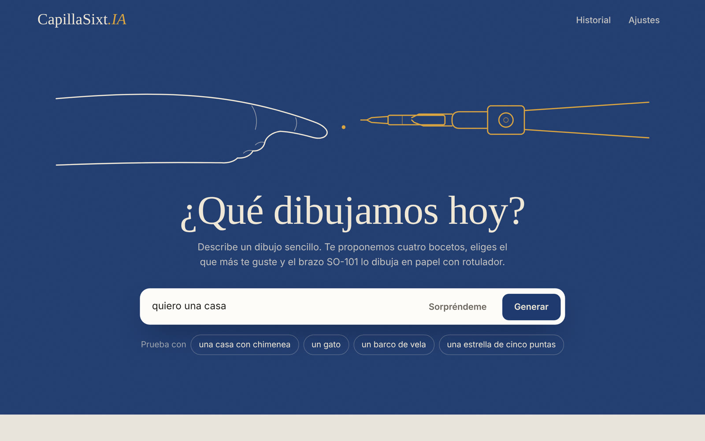
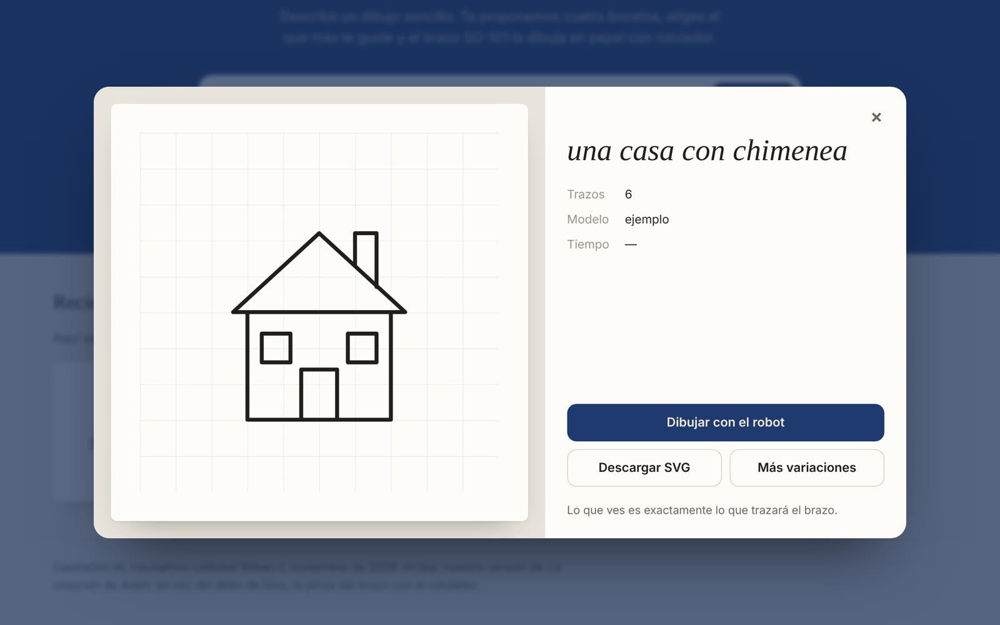
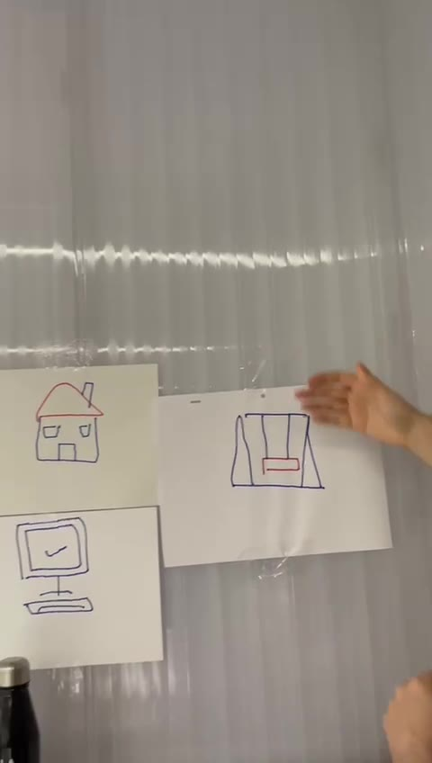
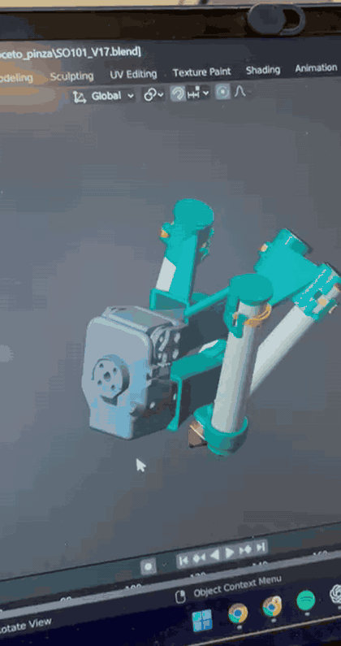

# Robot pintor SO-101: del prompt al papel

Escribes en una web lo que quieres ("quiero una casa"). La IA te propone **4 bocetos**, eliges uno y el brazo robótico **SO-101** (LeRobot) lo dibuja en un folio con rotulador, a **uno o dos colores**.

Proyecto del equipo **CapillaSixt.IA** en el **Hackathon LeRobot Bilbao II, Physical AI Hackathon** (La Perrera, Bilbao, 20-22 nov 2026).


## Equipo

| Quién | Qué hizo |
|---|---|
| **Íñigo Guzmán** (autor de este repo) | Desarrollo de la web, conexión web → brazo y montaje del vídeo |
| **Ander Mont** | Modelado 3D en Blender del cabezal porta-rotuladores multicolor (23 versiones, unas 6 horas de trabajo) y montaje del cabezal en el brazo |
| **Alfred** | Calibración del brazo y pruebas punto a punto sobre la hoja, y el software del robot: servidor, paso de SVG a trazos, planificación del movimiento y cambio de color |

La idea (un robot que dibuja lo que le pides con lenguaje natural, con una persona participando en la demo) salió entre todo el equipo.

El proyecto se divide en tres piezas que tienen que encajar: **la web** decide *qué* se dibuja, **el cabezal** sujeta los rotuladores y **la calibración** consigue que el brazo dibuje *donde* debe.

## Mi parte: la web y la conexión con el brazo
- **Web** ([`web/robot-dibujante.html`](web/robot-dibujante.html)): a partir de un prompt genera 4 bocetos SVG con un LLM, enseña una vista previa animada trazo a trazo y deja elegir el dibujo y si se hace con uno o dos colores.
- **Conexión web → brazo:** la web manda el SVG elegido al servidor del robot (`POST /draw`), que lo convierte en trazos y lo dibuja.
- **Vídeo:** montaje del vídeo de la demo.

## La web

| Inicio | Boceto elegido, listo para dibujar |
|---|---|
|  |  |

**Cuatro propuestas para "una casa con chimenea" durante la demo:**

<p align="center"></p>

### Cómo funciona

```
Prompt ("quiero una casa")
   │
   ▼
Web (HTML + JS, sin backend)
   │  4 peticiones en paralelo al LLM → 4 SVG de líneas (viewBox 0-100)
   │  limpieza y validación del SVG (solo formas básicas, sin scripts)
   │  la persona elige un boceto y si se dibuja con 1 o 2 colores
   ▼
POST http://localhost:8000/draw  {svg}
   │
   ▼
Servidor del robot (Python + LeRobot)
   │  SVG → trazos en mm → trayectoria → ángulos de motor
   ▼
Brazo SO-101 dibujando en el folio
```

- **Proveedores de LLM:** Groq, Google Gemini, OpenRouter o Claude. Se eligen en *Ajustes*.
- **System prompt** pensado para que salgan dibujos que un brazo pueda trazar: pocas formas, coordenadas enteras, sin rellenos ni texto.
- **Seguridad:** la API key se guarda solo en el `localStorage` del navegador y el SVG se sanea antes de mostrarlo.
- **Diseño:** inspirado en la Capilla Sixtina, con una versión de *La creación de Adán* en la que una pinza con rotulador sustituye al dedo de Dios.

### Probarla
1. Abre `web/robot-dibujante.html` en el navegador.
2. En **Ajustes**, elige proveedor y pega tu API key.
3. Escribe algo ("un gato") y pulsa **Generar**. Si no hay robot conectado, puedes descargar el SVG.

## Resultados

| Dibujo a dos colores | Dibujos finales |
|---|---|
|  |  |

## El hardware: cabezal multicolor (Ander Mont)
Ander modeló en Blender un cabezal que monta varios rotuladores alrededor de la muñeca del SO-101. Para cambiar de color, el brazo gira la muñeca (`wrist_roll`) sin soltar el rotulador. Llegó a la versión final tras 23 iteraciones.

<p align="center"><br><sub>Modelo 3D del cabezal porta-rotuladores, de Ander Mont</sub></p>

## La calibración y el software del robot (Alfred)
Alfred calibró el brazo sobre la hoja con una plantilla de cruces de referencia. Fue registrando punto a punto la postura de los motores en cada cruz, para cada rotulador por separado. También hizo el software que convierte el SVG de la web en movimientos del brazo. Lo que hizo falta para que funcione está detallado en la sección siguiente.

## Todo lo que hizo falta para que funcione
Esta es la parte de Alfred, en detalle:

- **Plantilla de calibración:** un A4 impreso con cruces cada 17 mm. Es la referencia física para calibrar y para colocar la hoja siempre igual.
- **Calibración por rotulador:** 45 puntos (rejilla de 9×5, uno cada 34 mm) para cada color. Entre puntos se interpola con Catmull-Rom; con puntos más separados las curvas se deformaban.
- **Nivelación:** se mide la altura real de contacto con el papel en 5 puntos, para que el rotulador no apriete de más ni se quede en el aire.
- **De SVG a trazos:** el SVG se convierte en polilíneas en milímetros. Se encaja y centra en la hoja, se simplifica, se ordenan los trazos para viajar lo mínimo y se agrupan por color.
- **Planificación del movimiento:** bajar despacio los últimos milímetros, pintar, subir y viajar, frenando en las curvas cerradas, con órdenes a 100 Hz. Antes de mover nada se comprueba el recorrido entero: si algún punto no se alcanza o hay un salto brusco, no se dibuja.
- **Cambio de color:** cada rotulador tiene su propia calibración; el brazo gira la muñeca para pasar de uno a otro y se corrige el desfase que queda entre ellos.
- **Servidor del robot:** un servidor HTTP local (`/draw`, `/status`, `/stop`) que recibe el SVG de la web, dibuja un trabajo cada vez y permite parar en cualquier momento.
- **Seguridad del hardware:** velocidades bajas, modo de prueba en el aire o simulado antes de pintar, y parada de emergencia con cualquier tecla.
- **Dataset:** cada dibujo se guarda como SVG + JSON (trazos, parámetros y resultado) para la entrega del hackathon.

Stack: SO-101 con servos Feetech STS3215 · LeRobot 0.7 · Python · HTML/JS · LLMs vía API (Groq, Gemini, OpenRouter, Claude).

## Créditos
Proyecto en equipo de **CapillaSixt.IA**: Íñigo Guzmán, Ander Mont y Alfred.

Tecnología: [SO-101 / SO-ARM100](https://github.com/TheRobotStudio/SO-ARM100) · [LeRobot](https://github.com/huggingface/lerobot)

## Licencia
Código de la web bajo licencia MIT. Ver [LICENSE](LICENSE).
